# Orders API: Serverless REST with AWS Lambda and API Gateway

A small **Order Management API** written in plain Java 17, tested with JUnit, packaged with Maven and exposed through **Amazon API Gateway** and **AWS Lambda** in two different ways:

- **Architecture A**: API Gateway non-proxy integration. API Gateway does the HTTP work with mapping templates.
- **Architecture B**: Lambda proxy integration. A thin Java HTTP adapter does the HTTP work.

The same business logic (`OrderService`) is used by both. It never sees HTTP, API Gateway or Lambda.

## Contents

1. [Quick start](#1-quick-start)
2. [Project structure](#2-project-structure)
3. [API contract](#3-api-contract)
4. [Part I: the application in plain Java](#4-part-i-the-application-in-plain-java)
5. [Part II: Java function on AWS Lambda](#5-part-ii-java-function-on-aws-lambda)
6. [Parts III and IV: Architecture A, API Gateway mapping](#6-parts-iii-and-iv-architecture-a-api-gateway-mapping)
7. [Part V: Architecture B, Lambda proxy integration](#7-part-v-architecture-b-lambda-proxy-integration)
8. [Comparing the two architectures](#8-comparing-the-two-architectures)
9. [Final challenge: DELETE /orders/{id}](#9-final-challenge-delete-ordersid)
10. [Final architecture diagram](#10-final-architecture-diagram)
11. [Working with an AI assistant](#11-working-with-an-ai-assistant)
12. [How to deploy](#12-how-to-deploy)
13. [Screenshots](#13-screenshots)
14. [Demo video](#14-demo-video)

---

## 1. Quick start

Requirements: Java 17 or newer, Maven 3.9+.

```bash
mvn test
```

```bash
mvn package
```

`mvn package` runs the tests again and creates `target/orders-api-1.0.0.jar`, a single "uber JAR" (about 3.5 MB) with our classes plus the Lambda and Jackson libraries. That one JAR is uploaded to every Lambda function; each function just points to a different handler inside it.

To deploy, see [section 12](#12-how-to-deploy).

## 2. Project structure

```
orders-api/
├── pom.xml
├── README.md
├── apigateway/
│   ├── architecture-a-mapping-openapi.yaml   API Gateway config, non-proxy + mapping templates
│   └── architecture-b-proxy-openapi.yaml     API Gateway config, proxy integration
├── deploy/deploy.sh                          AWS CLI script: Lambdas + both APIs
├── docs/
│   ├── delete-prediction.md                  Prediction written before implementing DELETE
│   ├── Demonstration.mp4                     Demo video (Git LFS)
│   └── evidence/                             Screenshots of the Lambdas, API Gateway and curl calls
├── events/                                   JSON used to invoke the Lambdas by hand
│   ├── direct-*.json                         inputs for the direct (Part II / Architecture A) functions
│   └── proxy-*.json                          API Gateway proxy events (Architecture B)
├── examples/curl-examples.sh                 calls every endpoint of a deployed API
└── src/
    ├── main/java/edu/escuelaing/orders/
    │   ├── domain/            Order, CreateOrderRequest                       plain Java
    │   ├── application/       OrderService, OrderRepository, exceptions        plain Java
    │   ├── persistence/       InMemoryOrderRepository                          plain Java
    │   ├── OrdersApplication  wires the service (composition root)             plain Java
    │   └── lambda/
    │       ├── direct/        DirectOrderFunctions + input DTOs  (Architecture A, no AWS imports)
    │       └── proxy/         OrdersApiHandler, ErrorResponse    (Architecture B, AWS events)
    └── test/java/...          JUnit 5 tests for every layer
```

The dependency direction is always inwards: `lambda.*` -> `application` -> `domain`. Nothing in `domain`, `application` or `persistence` imports an AWS, HTTP or Jackson class.

## 3. API contract

The contract was written before the code.

### Resource representation

```json
{
  "id": "ORD-001",
  "customerId": "CUST-42",
  "product": "MacBook Air",
  "quantity": 1
}
```

| Field | Type | Rules |
|---|---|---|
| `id` | string | Assigned by the server (`ORD-004`, `ORD-005`, ...). Clients never send it. |
| `customerId` | string | Required, not blank. |
| `product` | string | Required, not blank. |
| `quantity` | integer | Required, `>= 1`. |

Sample data loaded on every cold start: `ORD-001` (CUST-42, MacBook Air, 1), `ORD-002` (CUST-42, USB-C Hub, 2), `ORD-003` (CUST-7, Keyboard, 2).

### Error representation

Every error, from the application or from API Gateway itself, has the same shape:

```json
{
  "error": "ORDER_NOT_FOUND",
  "message": "Order ORD-999 does not exist"
}
```

- `error`: a stable, machine-readable code. Clients write `if` statements against it.
- `message`: a human-readable explanation. It can change wording without breaking clients.

| `error` code | HTTP status | When |
|---|---|---|
| `INVALID_REQUEST` | 400 | A business rule fails: missing field, `quantity < 1`, missing `customerId` in the search |
| `MALFORMED_JSON` | 400 | The body is missing, is not JSON, or has the wrong types (`"quantity": "abc"`) |
| `ORDER_NOT_FOUND` | 404 | No order with that id |
| `ROUTE_NOT_FOUND` | 404 | Method + path combination that the adapter does not know (Architecture B) |
| `INTERNAL_ERROR` | 500 | Anything unexpected. The message is generic on purpose; details go to CloudWatch Logs |

### Operations

#### Create an order

| | |
|---|---|
| Method / URL | `POST /orders` |
| Path params | none |
| Query params | none |
| Request body | `{"customerId": "CUST-42", "product": "MacBook Air", "quantity": 1}` |
| Success | `201 Created`, body = the created order, header `Location: /orders/ORD-004` |
| Errors | `400 INVALID_REQUEST`, `400 MALFORMED_JSON`, `500 INTERNAL_ERROR` |

#### Retrieve an order

| | |
|---|---|
| Method / URL | `GET /orders/{id}` |
| Path params | `id`, e.g. `ORD-001` |
| Query params | none |
| Request body | none |
| Success | `200 OK`, body = the order |
| Errors | `404 ORDER_NOT_FOUND`, `500 INTERNAL_ERROR` |

#### Find the orders of a customer

| | |
|---|---|
| Method / URL | `GET /orders?customerId={customerId}` |
| Path params | none |
| Query params | `customerId` (required) |
| Request body | none |
| Success | `200 OK`, body = JSON array of orders. A customer without orders gets `[]`, not 404 |
| Errors | `400 INVALID_REQUEST` (no `customerId`), `500 INTERNAL_ERROR` |

#### Delete an order (final challenge)

| | |
|---|---|
| Method / URL | `DELETE /orders/{id}` |
| Path params | `id` |
| Request body | none |
| Success | `204 No Content`, empty body |
| Errors | `404 ORDER_NOT_FOUND`, `500 INTERNAL_ERROR` |

### Design questions

**What are the resources in your API?**
There is one collection resource, `/orders` (all orders), and one item resource, `/orders/{id}` (a single order). Customers and products appear only as attributes of an order; they are not resources of this API because we do not create, read or delete them here.

**Why did you choose `/orders/{id}` to retrieve a particular order?**
In REST a URL identifies a resource. An individual order is a member of the `orders` collection, so its natural address is the collection plus its identifier. The id is part of the identity of the thing, which is exactly what the path is for. The same URL is then reused with other methods (`DELETE /orders/{id}`, and a future `PUT`), so the verb says *what* to do and the URL says *to what*.

**Why is `customerId` represented as a query parameter in the search operation?**
Because we are not addressing a new resource, we are *filtering* the `/orders` collection. Query parameters are the standard way to filter, sort or page a collection, they are optional by nature and they combine well (`?customerId=CUST-42&product=Mouse` later). A path like `/customers/{id}/orders` would also be valid REST, but it would introduce `customers` as a resource that this API does not otherwise manage.

**What should `POST /orders` return when an order is successfully created?**
`201 Created`, the created order in the body (so the client learns the generated `id` without a second call), and a `Location: /orders/ORD-004` header pointing to the new resource.

**What should the API return when an order does not exist?**
`404 Not Found` with `{"error": "ORDER_NOT_FOUND", "message": "Order ORD-999 does not exist"}`. Not `200` with an empty body and not `500`: the request was fine, the resource just is not there. A *search* with no results is different: it returns `200` with `[]`, because the collection exists, it just has no matching members.

**What information should an error response contain?**
A stable error code for programs, a readable message for people, and the HTTP status (in the status line, not repeated in the body). It must **not** contain stack traces, class names or other internal details. For 400 errors the message says which field is wrong (`quantity must be greater than 0`) so the client can fix the request.

## 4. Part I: the application in plain Java

The core is ordinary Java:

```java
public class OrderService {
    public Order createOrder(CreateOrderRequest request)          // throws InvalidOrderException
    public Order getOrder(String id)                              // throws OrderNotFoundException
    public List<Order> getOrdersByCustomer(String customerId)     // [] when there are none
}
```

- Validation lives in `OrderService`, because "quantity must be at least 1" is a business rule, not an HTTP rule. It reports *all* problems at once: `customerId is required; product is required; quantity is required`.
- Failures are domain exceptions (`InvalidOrderException`, `OrderNotFoundException`). They do not carry HTTP status codes or error codes; mapping them to HTTP is the adapters' job.
- Storage is behind the `OrderRepository` interface. `InMemoryOrderRepository` is a `ConcurrentHashMap` seeded with three orders. **It is not persistent**: Lambda environments are created and destroyed at any time, each one has its own copy of the map, and a cold start begins again from the sample data. Replacing it with DynamoDB would mean writing one new class that implements `OrderRepository`.
- Ids are generated by an injected `Supplier<String>` (`SequentialOrderIdGenerator`), so tests can control them.

### Tests

`mvn test` runs 40 tests (33 before the DELETE extension):

| Test class | What it covers |
|---|---|
| `OrderServiceTest` | valid creation, retrieval, missing order, search by customer, empty search, every invalid input, trimming, invalid orders are not stored |
| `DirectOrderFunctionsTest` | the Lambda entry points of Architecture A and the `CODE: message` format that API Gateway regexes depend on |
| `OrdersApiHandlerTest` | the HTTP adapter of Architecture B: 200, 201 + `Location`, 400 (rule and malformed JSON), 404, 500 without leaking details, and the saved API Gateway events in `events/` |

### Checkpoint 1

| Question | Answer |
|---|---|
| Can the functionality be tested without AWS? | Yes. All the tests (33 at this point, 40 at the end) run on a laptop with `mvn test`, no AWS account, no network. Even the Lambda handlers are tested by calling them as ordinary Java methods. |
| Does it require a web server? | No. There is no Tomcat, Netty or socket. In AWS, API Gateway receives HTTP and Lambda calls our methods. |
| Does it require Spring Boot? | No. There is no framework at all; `OrdersApplication` wires three objects by hand. |
| What does the generated JAR contain? | Our compiled classes (`domain`, `application`, `persistence`, `lambda`) plus, because of the Shade plugin, the classes of `aws-lambda-java-core`, `aws-lambda-java-events`, `jackson-*` and `joda-time` (a dependency of the events library). No `main` method and no server. `target/original-orders-api-1.0.0.jar` (20 KB) is the same thing without dependencies. |
| Which parts know about HTTP? | At the end of Part I: none. After Part V: only `lambda.proxy.OrdersApiHandler` (and its `ErrorResponse`). In Architecture A the HTTP knowledge is in API Gateway's configuration, not in Java. |

## 5. Part II: Java function on AWS Lambda

The class `lambda.direct.DirectOrderFunctions` exposes each operation as a Lambda handler. It does not implement any AWS interface: it is a normal class with normal methods that receive and return Java objects.

| Lambda function | Handler string | Input example |
|---|---|---|
| `orders-create-order` | `edu.escuelaing.orders.lambda.direct.DirectOrderFunctions::createOrder` | `events/direct-create-order.json` |
| `orders-get-order` | `edu.escuelaing.orders.lambda.direct.DirectOrderFunctions::getOrder` | `events/direct-get-order.json` |
| `orders-find-orders` | `edu.escuelaing.orders.lambda.direct.DirectOrderFunctions::findOrdersByCustomer` | `events/direct-find-orders.json` |
| `orders-delete-order` (final challenge) | `edu.escuelaing.orders.lambda.direct.DirectOrderFunctions::deleteOrder` | `events/direct-delete-order.json` |

Runtime: **Java 17**, memory 512 MB, timeout 15 s, code: `target/orders-api-1.0.0.jar`.

### Invoking it by hand

In the Lambda console: *Test* tab -> paste the JSON -> *Test*. With the CLI:

```bash
aws lambda invoke --function-name orders-create-order --cli-binary-format raw-in-base64-out --payload file://events/direct-create-order.json out.json
```

| Input | Expected output |
|---|---|
| `{"customerId": "CUST-42", "product": "MacBook Air", "quantity": 1}` | `{"id":"ORD-004","customerId":"CUST-42","product":"MacBook Air","quantity":1}` (first call after a cold start) |
| `{"customerId": "CUST-100", "product": "Mechanical Keyboard", "quantity": 3}` | `{"id":"ORD-005",...}` if the same warm environment handles it, `ORD-004` again after a cold start |
| `{"customerId": "CUST-42", "product": "", "quantity": 0}` | Function error: `{"errorMessage":"INVALID_REQUEST: product is required; quantity must be greater than 0","errorType":"edu.escuelaing.orders.lambda.direct.DirectFunctionException", ...}` |
| `{"customerId": "CUST-42", "product": "Monitor", "quantity": "2", "color": "black"}` | Created normally: `"2"` is converted to the number 2 and the unknown field `color` is ignored |
| `{"id": "ORD-999"}` (to `orders-get-order`) | Function error: `"errorMessage":"ORDER_NOT_FOUND: Order ORD-999 does not exist"` |

Screenshots of these invocations are in [section 13](#13-screenshots). In screenshot 01 the new order got `ORD-006` instead of `ORD-004` because the function was still warm after earlier tests. That shows the memory is kept only while the environment is alive.

### Investigation: how does Lambda turn JSON into Java objects and back?

What I found, after reading about it and checking it against the deployed function (see screenshots 01 and 02):

1. **The handler string tells the runtime what to call.** `Class::method` makes the runtime load the class from our JAR, create **one instance** with the public no-arg constructor (on the cold start, not per request) and find the method by name. The method can have the form `(Input)`, `(Input, Context)`, or implement `RequestHandler<I, O>` / `RequestStreamHandler`; none of that is required.
2. **Input.** The runtime looks at the declared parameter type. If it is `InputStream` it passes the raw bytes; if it is `String`, `Integer`, `Map`, `List` it converts directly; if it is a POJO, it uses its built-in serializer (`aws-lambda-java-serialization`, an internal, shaded **Jackson**) to map JSON fields to properties by name, using the no-arg constructor and setters. So `{"id": "ORD-001"}` becomes `new OrderIdInput()` + `setId("ORD-001")`.
3. **Lenient mapping.** Unknown JSON fields are ignored (`color` above), missing fields stay `null` (that is why `quantity` is an `Integer` and not an `int`: a missing quantity is `null` and is rejected, instead of silently becoming `0`), and simple coercions like `"2"` -> `2` work. JSON that cannot be mapped (e.g. `"quantity": "abc"`) fails **before our code runs**, with an error like `An error occurred during JSON parsing`.
4. **Output.** The return value goes through the same serializer: public getters become JSON fields (`getCustomerId()` -> `"customerId"`). A `List<Order>` becomes a JSON array. A `void` method returns `null`.
5. **Errors.** An uncaught exception becomes `{"errorMessage": e.getMessage(), "errorType": <class name>, "stackTrace": [...]}` and the invocation is marked as failed (the CLI shows `"FunctionError": "Unhandled"`). This is what Architecture A uses to pick HTTP status codes.
6. **Special types.** Classes from `aws-lambda-java-events` (such as `APIGatewayProxyRequestEvent`) are recognized by the runtime and deserialized with their own rules. That is what Architecture B relies on.

Practical consequences for our design: classes that cross the Lambda boundary are plain classes with getters (and setters for inputs), not Java records, because we cannot control which Jackson version and settings the runtime's internal serializer uses.

### Checkpoint 2: what actually happens

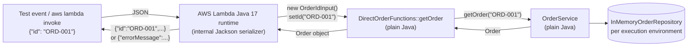

## 6. Parts III and IV: Architecture A, API Gateway mapping

Config: [`apigateway/architecture-a-mapping-openapi.yaml`](apigateway/architecture-a-mapping-openapi.yaml) (an OpenAPI file with `x-amazon-apigateway-integration` extensions that can be imported directly into API Gateway).

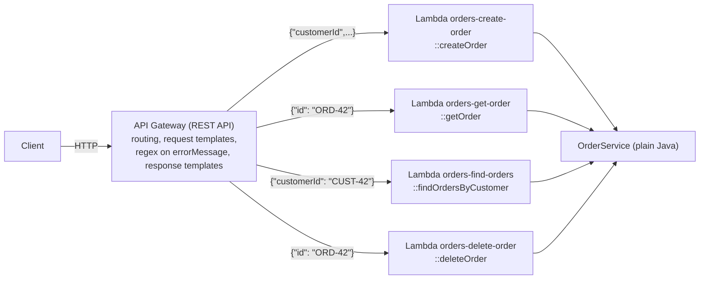

### Request mapping

`GET /orders/ORD-42`: API Gateway reads `{id}` from the path and builds the Lambda input:

```velocity
{
  "id": "$util.escapeJavaScript($input.params().path.get('id'))"
}
```

`GET /orders?customerId=CUST-42`:

```velocity
{
  "customerId": "$util.escapeJavaScript($input.params().querystring.get('customerId'))"
}
```

If `customerId` is missing, the template produces `""` and `OrderService` rejects it with `INVALID_REQUEST`. (We chose not to mark it as required in an API Gateway request validator so that the rule lives in one place.)

`POST /orders`: the body already has the shape of `CreateOrderRequest`, so the template is `$input.json('$')`.

The Java code never sees a URL, a header or a query string. `DirectOrderFunctions::getOrder` only receives `OrderIdInput{id="ORD-42"}`.

### Response and error mapping

A non-proxy Lambda cannot return a status code. It either returns a value (success) or throws (error). API Gateway decides the status:

- **Success** -> the `default` integration response: `200` for GETs, `201` for POST. For POST the template also sets the `Location` header:
  ```velocity
  #set($context.responseOverride.header.Location = "/orders/$input.path('$.id')")
  $input.json('$')
  ```
- **Errors** -> API Gateway matches a regex against the Lambda's `errorMessage`. That is why `DirectOrderFunctions` rethrows domain exceptions as `DirectFunctionException("ORDER_NOT_FOUND", ...)`, whose message is `ORDER_NOT_FOUND: Order ORD-42 does not exist`.

| Selection pattern (regex on `errorMessage`) | Status | Body built by the template |
|---|---|---|
| `ORDER_NOT_FOUND: .*` | 404 | `{"error": "ORDER_NOT_FOUND", "message": "<text after the code>"}` |
| `INVALID_REQUEST: .*` | 400 | `{"error": "INVALID_REQUEST", "message": "<text after the code>"}` |
| `(?s)An error occurred during JSON parsing.*` (POST only) | 400 | `{"error": "MALFORMED_JSON", ...}` |
| `(?s)(?!INVALID_REQUEST: \|ORDER_NOT_FOUND: ...).+` | 500 | `{"error": "INTERNAL_ERROR", "message": "An unexpected error occurred"}` |

The error template:

```velocity
#set($msg = $input.path('$.errorMessage'))
#set($start = $msg.indexOf(': ') + 2)
{
  "error": "ORDER_NOT_FOUND",
  "message": "$util.escapeJavaScript($msg.substring($start))"
}
```

> **Trap we found:** without the last "catch-all" regex, an unexpected exception (one whose message does not match any pattern) falls into the `default` response, so the client gets **`200 OK` with the Lambda error JSON as the body**. In this architecture *getting a 500* is something you have to configure.

### Testing it

```bash
curl -i https://<api-id>.execute-api.<region>.amazonaws.com/Alpha_dev/orders/ORD-001
curl -i https://<api-id>.execute-api.<region>.amazonaws.com/Alpha_dev/orders/ORD-999
curl -i "https://<api-id>.execute-api.<region>.amazonaws.com/Alpha_dev/orders?customerId=CUST-42"
curl -i "https://<api-id>.execute-api.<region>.amazonaws.com/Alpha_dev/orders?customerId=CUST-100"
curl -i -X POST https://<api-id>.execute-api.<region>.amazonaws.com/Alpha_dev/orders -H "Content-Type: application/json" -d '{"customerId":"CUST-42","product":"MacBook Air","quantity":1}'
curl -i -X POST https://<api-id>.execute-api.<region>.amazonaws.com/Alpha_dev/orders -H "Content-Type: application/json" -d '{"customerId":"CUST-42","product":"","quantity":0}'
```

Or run everything at once: `./examples/curl-examples.sh <invoke URL>`.

Expected results:

| Request | Status | Body |
|---|---|---|
| `GET /orders/ORD-001` | 200 | `{"id":"ORD-001","customerId":"CUST-42","product":"MacBook Air","quantity":1}` |
| `GET /orders/ORD-999` | 404 | `{"error":"ORDER_NOT_FOUND","message":"Order ORD-999 does not exist"}` |
| `GET /orders?customerId=CUST-42` | 200 | `[{"id":"ORD-001",...},{"id":"ORD-002",...}]` |
| `GET /orders?customerId=CUST-100` | 200 | `[]` |
| `GET /orders` | 400 | `{"error":"INVALID_REQUEST","message":"customerId is required"}` |
| `POST /orders` valid | 201 | the new order, `Location: /orders/ORD-004` |
| `POST /orders` with `quantity: 0` | 400 | `{"error":"INVALID_REQUEST","message":"product is required; quantity must be greater than 0"}` |
| `DELETE /orders/ORD-002` | 204 | empty |
| `DELETE /orders/ORD-002` again | 404 | `{"error":"ORDER_NOT_FOUND","message":"Order ORD-002 does not exist"}` |

> **Important side effect of one Lambda per operation:** after `POST /orders` creates `ORD-004` in `orders-create-order`, `GET /orders/ORD-004` returns **404**, because `orders-get-order` is a different function with its own memory. The sample orders work in every function because each one loads them on its cold start. This is the in-memory limitation made visible; with a real database it disappears.

### Checkpoint 3: what is API Gateway responsible for in Architecture A?

| Responsibility | Where |
|---|---|
| Routing (`GET /orders/{id}` -> `orders-get-order`) | API Gateway resources + methods |
| Extracting path parameters | request template (`$input.params().path`) |
| Extracting query parameters | request template (`$input.params().querystring`) |
| Transforming the request into the Lambda's input JSON | request templates |
| Transforming the response | response templates (`$input.json('$')`) |
| Choosing the success status code (200 vs 201) | `default` integration response per method |
| Choosing error status codes | regexes on `errorMessage` |
| Building the error JSON | error response templates |
| Response headers (`Location`) | `$context.responseOverride` in the template |
| Hiding internal errors (500 instead of 200) | catch-all regex |
| Gateway-level errors in our format | `x-amazon-apigateway-gateway-responses` |

Java is responsible only for the business rules and for putting a stable code at the start of exception messages.

**Advantages**

- The Java code is as pure as it gets: `DirectOrderFunctions` has no AWS imports and no idea that HTTP exists. The same functions can be called from Step Functions, SQS or another Lambda without changes.
- The HTTP contract is declared in one place (the OpenAPI file). Changing a status code or renaming a field in the response does not require recompiling or redeploying Java.
- Each operation is a separate function: independent memory/timeout settings, independent permissions, and a bug in one cannot break another.
- API Gateway can reject bad requests before paying for a Lambda invocation (with request validators).

**Disadvantages**

- The HTTP behavior is written in Velocity templates and regexes inside YAML. It is hard to read, it has no compiler and **it cannot be unit tested locally**: every mistake is discovered after a deploy.
- There is a hidden contract between two places: Java must produce `"ORDER_NOT_FOUND: ..."` and the regex must match it. Renaming a code in Java breaks the API silently (it becomes a 500 or, worse, a 200).
- The defaults are dangerous (unmatched errors become `200 OK`).
- It is verbose: the same error templates are repeated in every method.
- Lambda errors are reported as function failures in CloudWatch metrics, even when they are an ordinary "not found".
- It ties the HTTP layer to API Gateway REST APIs specifically (HTTP APIs do not support mapping templates).

## 7. Part V: Architecture B, Lambda proxy integration

Config: [`apigateway/architecture-b-proxy-openapi.yaml`](apigateway/architecture-b-proxy-openapi.yaml). Every route uses `type: aws_proxy` and points to **one** function:

| Lambda function | Handler |
|---|---|
| `orders-api-proxy` | `edu.escuelaing.orders.lambda.proxy.OrdersApiHandler::handleRequest` |

There are no request templates, no integration responses and no regexes.

### The event API Gateway sends

Saved examples: [`events/proxy-get-order.json`](events/proxy-get-order.json), [`events/proxy-find-orders.json`](events/proxy-find-orders.json), [`events/proxy-post-order.json`](events/proxy-post-order.json). A test (`handlesTheSavedApiGatewayEvents`) feeds them to the handler, so they cannot silently get out of date.

| Information | Field in the event | Example |
|---|---|---|
| HTTP method | `httpMethod` (also `requestContext.httpMethod`) | `"GET"` |
| Path | `path` (real path) and `resource` (matched template) | `"/orders/ORD-001"`, `"/orders/{id}"` |
| Path parameters | `pathParameters` | `{"id": "ORD-001"}` |
| Query parameters | `queryStringParameters` (+ `multiValueQueryStringParameters`) | `{"customerId": "CUST-42"}` |
| Headers | `headers` (+ `multiValueHeaders`) | `{"Content-Type": "application/json", ...}` |
| Request body | `body`, **as a string** (base64 if `isBase64Encoded` is true) | `"{\"customerId\":\"CUST-42\",...}"` |
| Stage, request id, caller IP... | `requestContext` | `"stage": "Alpha_dev"` |

Note that the body is a JSON *string inside* the JSON event, so the handler has to parse it itself. Absent parameters are `null`, not empty maps.

The handler must answer with this shape (API Gateway turns it into the real HTTP response):

```json
{ "statusCode": 201, "headers": {"Content-Type": "application/json", "Location": "/orders/ORD-004"}, "body": "{\"id\":\"ORD-004\",...}" }
```

### The HTTP adapter

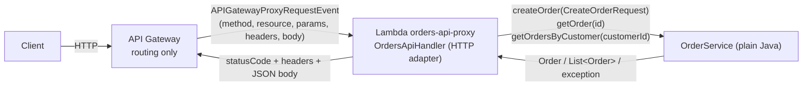

`OrdersApiHandler` is deliberately thin:

1. **Route** on `httpMethod + " " + resource` (`"GET /orders/{id}"`). Using `resource` instead of parsing `path` reuses the routing API Gateway already did.
2. **Extract** the inputs (`pathParameters.id`, `queryStringParameters.customerId`, body parsed with Jackson into `CreateOrderRequest`).
3. **Call** `OrderService`.
4. **Translate** the outcome into HTTP:

| Outcome | Status | Body / headers |
|---|---|---|
| `Order` from `createOrder` | 201 | order JSON, `Location: /orders/{id}` |
| `Order` / `List<Order>` from a GET | 200 | JSON |
| `deleteOrder` returns normally | 204 | no body |
| `InvalidOrderException` | 400 | `INVALID_REQUEST` |
| body missing / not JSON / wrong types | 400 | `MALFORMED_JSON` |
| `OrderNotFoundException` | 404 | `ORDER_NOT_FOUND` |
| unknown method + resource | 404 | `ROUTE_NOT_FOUND` |
| any other `RuntimeException` | 500 | `INTERNAL_ERROR`, generic message; the real exception is logged to CloudWatch |

**Is a `Location` header appropriate after creating?** Yes. RFC 9110 says a `201 Created` response identifies the new resource, usually through `Location`. Since we also return the full order in the body, the header is not strictly necessary for our own clients, but it is the standard signal and generic HTTP tools understand it. Both architectures send it. We use a relative URL (`/orders/ORD-004`) because the handler does not know the stage name or the public domain; building an absolute URL would mean reading `requestContext` and would break behind a custom domain.

**Unexpected internal errors.** In B the handler catches every `RuntimeException`, logs it and returns `500` with the generic `INTERNAL_ERROR` body. If something escapes even that (for example `OutOfMemoryError`, a timeout, or a failure during class initialization), the Lambda invocation fails and API Gateway itself answers `502 Bad Gateway` ("Internal server error"); our `DEFAULT_5XX` gateway response still gives it the `{"error", "message"}` shape. In A, the catch-all regex gives `500 INTERNAL_ERROR`; Lambda timeouts become `504` from API Gateway.

### Testing it

The same `curl` commands as in Architecture A work against the proxy API, with the same status codes and bodies. The difference you can see: `POST` and then `GET /orders/ORD-004` **does** find the new order, because both requests go to the same function (as long as the same warm environment serves them).

## 8. Comparing the two architectures

```
Architecture A                              Architecture B
HTTP request                                HTTP request
   │                                           │
API Gateway                                 API Gateway
 - routing                                   - routing
 - parameter extraction (VTL)                  │
 - request transformation (VTL)             Lambda HTTP adapter (OrdersApiHandler)
 - status codes (regex)                      - parameter extraction
 - response/error mapping (VTL)              - status codes, headers, error JSON
   │                                           │
Lambda per operation (DirectOrderFunctions) OrderService
   │
OrderService
```

| Question | Architecture A (mapping) | Architecture B (proxy) |
|---|---|---|
| Which required more API Gateway configuration? | **A, by far.** About 250 lines of OpenAPI with request templates, four regexes per method and repeated error templates. | About 60 lines: three routes, all `aws_proxy` to the same function. |
| Which required more Java infrastructure code? | Little: `DirectOrderFunctions` (~20 real lines) and two tiny input DTOs. | **B.** `OrdersApiHandler` (~110 lines) with routing, parsing, error translation and serialization. |
| Which was easier to test locally? | The Java side is trivial to test, but the HTTP behavior (status codes, templates, regexes) **cannot** be tested without deploying. | **B.** Every status code and header is covered by JUnit (`OrdersApiHandlerTest`), and the saved real events can be replayed. |
| Where are HTTP status codes defined? | In API Gateway: `default` integration responses (200/201) and selection-pattern regexes (400/404/500). | In Java, in `OrdersApiHandler` (`json(201, ...)`, `catch (OrderNotFoundException e) -> 404`). |
| What happens at 30 operations? | 30 functions (or 30 integrations), each with a request template, 3 or 4 regexes and error templates. Lots of copy-paste in YAML, many deploy-only bugs. Cold starts multiply (each function warms up separately). | Still one function and a 30-case routing table; error translation is written once. The handler grows and would need to be split (one small class per resource, or a tiny router library). Deploying one function means redeploying all routes. |
| Which makes the business logic cleaner? | **Both are equally clean**: `OrderService` is identical. A even keeps the Lambda entry points free of AWS imports. | Same `OrderService`. The AWS-specific code is confined to one adapter class. |
| Which is easier for another developer to understand? | Harder. The behavior is split between Java and VTL/regex in YAML, connected by a string convention (`"CODE: message"`). | **Easier.** One request -> one Java method you can read top to bottom, step through in a debugger, and test. |
| Which would I choose for a larger system? | For very simple pass-through endpoints, or when the gateway must integrate directly with AWS services (no Lambda at all, e.g. API Gateway -> DynamoDB/SQS). | **B**, explained below. |

**Which would I choose and why.** For a larger system I would choose **Architecture B** (proxy integration with a thin adapter), because:

1. The HTTP contract is *behavior*, and behavior should be in code we can test. In A, the most error-prone part of an API (status codes and error shapes) is exactly the part that cannot be unit tested.
2. It does not create a hidden string-matching contract between Java and the gateway.
3. It keeps the business logic just as clean as A, as long as the adapter stays thin. The discipline is "the adapter translates, the service decides".
4. It is portable: the same adapter idea works with HTTP APIs, Function URLs or an Application Load Balancer, and the service could be put behind Spring or Javalin later without changes.

I would not use one function for 30 operations forever: I would group by resource or bounded context (`orders-api`, `customers-api`...), each a proxy Lambda with its own adapter. And I would keep using API Gateway for what it is genuinely good at: authentication (Cognito/JWT authorizers), throttling, API keys, CORS and request size limits.

## 9. Final challenge: DELETE /orders/{id}

The prediction is in [`docs/delete-prediction.md`](docs/delete-prediction.md). It was committed *before* the implementation (`git log` shows the prediction commit first); the comparison with what was actually done is at the end of that file.

What changed:

| Layer | Change |
|---|---|
| `OrderRepository` / `InMemoryOrderRepository` | `boolean deleteById(String id)` |
| `OrderService` | `void deleteOrder(String id)`: throws `OrderNotFoundException` if nothing was deleted |
| Architecture A | new function `orders-delete-order` -> `DirectOrderFunctions::deleteOrder` (returns `void`); new `DELETE /orders/{id}` method with a request template, `default` -> **204** with an empty template, and the same 404/400/500 regexes |
| Architecture B | one `case "DELETE /orders/{id}"` in `OrdersApiHandler` returning 204; one new method in the OpenAPI file pointing to the **existing** function |
| Tests | 7 new tests (service, direct function, adapter, saved `events/proxy-delete-order.json`) |

The 404 case needed **no new code** in either architecture: "not found" was already an exception in the service and already mapped to 404 by both adapters. That is the payoff of keeping the decision ("did it exist?") in the service and the translation (204/404) at the edge.

Note on idempotency: `DELETE` is idempotent in HTTP terms because the *state* after one or many calls is the same (the order is gone). Returning 404 on the second call does not break that; it just reports that there was nothing to delete.

## 10. Final architecture diagram

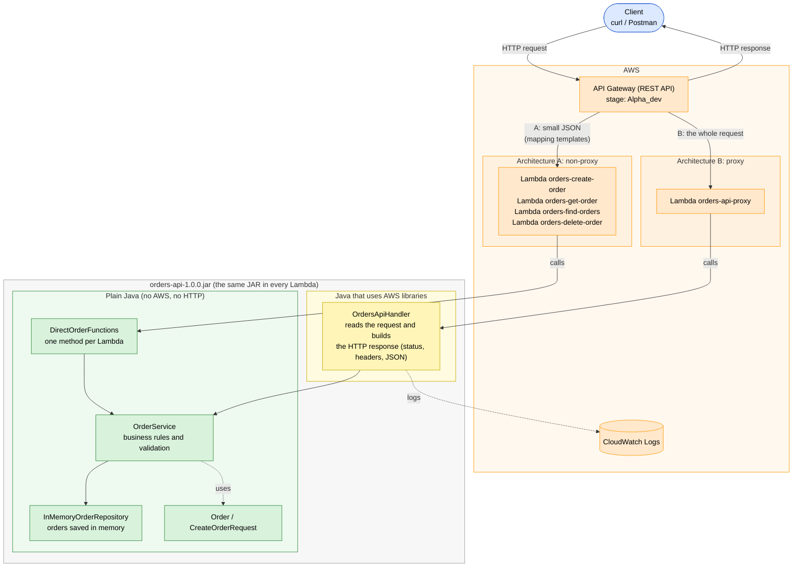

**Colors**

| Color | What it is |
|---|---|
| Blue | The client that calls the API |
| Orange | AWS services: API Gateway, the Lambdas and CloudWatch |
| Yellow | Our Java that uses AWS libraries. Only `OrdersApiHandler`, because it reads the API Gateway event |
| Green | Plain Java. It runs and is tested without AWS |

The arrows show who calls whom; the response goes back the same way. Both architectures use the same `OrderService`. The only difference is who does the HTTP part: API Gateway in A, `OrdersApiHandler` in B.

## 11. Working with an AI assistant

I used Claude Code as a coding assistant. Before writing code I asked it to explain the architecture first: which classes it would create, which files would change and where the HTTP logic would go. Then I went through its decisions one by one. These are the ones that mattered most.

### Decision 1: one Lambda per operation in A, one Lambda for everything in B

- **What it proposed:** In Architecture A, each operation is its own function (`orders-get-order`, ...), each one pointing to a different method of the same class. In Architecture B, a single function for all the routes.
- **Why I think it proposed it:** With the non-proxy integration each method has its own templates, so one function per method fits naturally. For the proxy, one function with a small router is the usual pattern.
- **Do I agree?** Partly. It fits each style, but it has a side effect: since the orders are kept in memory, **separate functions don't share data**. An order created by `orders-create-order` doesn't exist for `orders-get-order`, so in A the POST works but the GET of that new order gives 404. It looks like a bug if you don't know why.
- **Other option:** One "dispatcher" Lambda for A, where the mapping template adds an `"action"` field. Memory would be shared, but the Lambda would become a router driven by strings from the gateway, and the two architectures would get mixed up.
- **What I did:** I kept one function per operation in A and explained the side effect in section 6. The problem comes from keeping data in memory, not from the architecture. With a real database like DynamoDB it goes away, so hiding it with a dispatcher didn't make sense.

### Decision 2: where validation and error codes live

- **What it considered:** A base `OrderException` with an error code (`"ORDER_NOT_FOUND"`, `"INVALID_REQUEST"`), so both adapters could just read `e.getCode()`.
- **Why I think it considered it:** It avoids repeating the mapping in two places, and it's a very common pattern (Spring's `ResponseStatusException` even carries the HTTP status).
- **Do I agree?** No. The codes belong to the API contract, not to the business rules. Once they're inside `application`, the next step is adding the HTTP status there too, and that's exactly what I wanted to avoid. In the end the assistant went with the other option before writing the code.
- **Other option:** Plain domain exceptions (`OrderNotFoundException`, `InvalidOrderException`) and each adapter translates them.
- **What I did:** Plain domain exceptions with no codes or statuses. `OrdersApiHandler` turns them into 400, 404 or 500, and `DirectOrderFunctions` turns them into the `CODE: message` text that the API Gateway regexes read. Validation stays in `OrderService`, and only broken JSON is caught in the adapter. It means two small mapping blocks instead of one, but the dependencies stay clean.

### Decision 3: using the AWS event classes (`APIGatewayProxyRequestEvent`)

- **What it proposed:** Implement `RequestHandler<APIGatewayProxyRequestEvent, APIGatewayProxyResponseEvent>` from `aws-lambda-java-events`.
- **Why I think it proposed it:** It's the documented way, it's typed, the runtime already knows how to read it, and the IDE autocompletes the fields.
- **Do I agree?** Yes, but only in the adapter. The other options were a `Map<String, Object>` (no types, lots of casting) or `RequestStreamHandler` with my own classes (more control, more code). The adapter is supposed to be the part that knows about AWS, so using AWS classes there is fine.
- **What I did:** The event classes are only used in `lambda.proxy`. The tests build the events with the `withX()` methods and also load the saved real events, so the handler can be tested without AWS.

### Decision 4: error codes inside the message for Architecture A

- **What it proposed:** Put the error code at the start of the exception message (`ORDER_NOT_FOUND: ...`) and use regex selection patterns in API Gateway, plus a last regex that catches everything else as 500.
- **Why I think it proposed it:** API Gateway only lets the regexes look at `errorMessage`. A non-proxy Lambda has no other way to say which error happened.
- **Do I agree?** Yes, it's the standard way, and the catch-all regex for 500 is something many tutorials forget. But it's fragile, so I added a test (`DirectOrderFunctionsTest`) that checks the exact message format. That way a change in Java can't break the gateway without a test failing.
- **Other option:** Throw the whole error JSON as the message and use `$input.path('$.errorMessage')` as the body. Fewer template lines, but JSON inside an exception message is messy and easy to break.

### Decision 5: generating ids in memory

- **What it proposed:** Sequential ids (`ORD-004`, `ORD-005`) with an `AtomicInteger`.
- **Do I agree?** For a demo, yes: they're easy to read, and tests can control them because the generator is injected. In production it's wrong, because two Lambda environments running at the same time would both create `ORD-004`. With a real database I would use UUIDs or let the database generate the key.

## 12. How to deploy

### Option 1: script (AWS CLI / CloudShell)

1. `mvn package`
2. Open AWS CloudShell (or any shell with the AWS CLI and credentials) and upload the repository, or at least `target/orders-api-1.0.0.jar`, `apigateway/` and `deploy/`.
3. Run:

```bash
./deploy/deploy.sh all
```

It creates the five Lambda functions (Java 17, role `LabRole` by default, override with `LAMBDA_ROLE_ARN`), imports both OpenAPI files as two REST APIs, grants API Gateway permission to invoke the functions and deploys the stage (`STAGE`, default `Alpha_dev`). It prints both invoke URLs.

### Option 2: console, by hand

**Lambda** (repeat per function in the tables of sections 5 and 7):
1. Lambda -> *Create function* -> *Author from scratch*, runtime **Java 17**, execution role: existing role (`LabRole` in the Learner Lab).
2. *Code* -> *Upload from* -> *.zip or .jar file* -> `target/orders-api-1.0.0.jar`.
3. *Runtime settings* -> *Edit* -> *Handler*: e.g. `edu.escuelaing.orders.lambda.direct.DirectOrderFunctions::getOrder`.
4. *Configuration* -> *General* -> memory 512 MB, timeout 15 s.
5. *Test* with the matching file from `events/`.

**API Gateway, quickest:** *Create API* -> *REST API* -> *Import* -> paste the OpenAPI file after replacing `REGION_PLACEHOLDER` and `ACCOUNT_ID_PLACEHOLDER`. Then for each function run `aws lambda add-permission ...` (see the script) or open each method's *Integration request* -> *Edit* -> *Save*, which makes the console offer to add the permission. *Deploy API* -> new stage `Alpha_dev`.

**API Gateway, step by step (Architecture A):**
1. *Create resource* `/orders`, then child `/{id}`.
2. `GET` on `/{id}` -> integration type *Lambda function*, **Lambda proxy integration off**, function `orders-get-order`.
3. *Integration request* -> *Mapping templates* -> content type `application/json` -> template from section 6.
4. *Method response* -> add 404, 400, 500. *Integration response* -> add one entry per row of the regex table in section 6, each with its template.
5. Same for `GET /orders` (`orders-find-orders`), `POST /orders` (`orders-create-order`, default response 201 + `Location`), `DELETE /orders/{id}` (`orders-delete-order`, default response 204).
6. *Deploy API*.

**Architecture B:** create the same resources, and for every method choose *Lambda function* with **Lambda proxy integration on**, function `orders-api-proxy`. Nothing else. *Deploy API*.

## 13. Screenshots

All screenshots are in [`docs/evidence/`](docs/evidence/).

**01. `orders-create-order` invoked directly from the Lambda console.** The JSON input becomes a `CreateOrderRequest` and the returned `Order` comes back as JSON.

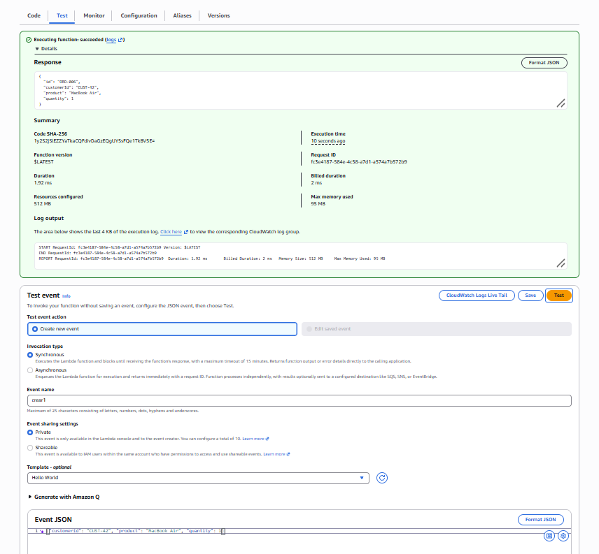

**02. `orders-create-order` with invalid data.** The function fails with `errorMessage: "INVALID_REQUEST: product is required; quantity must be greater than 0"`, plus `errorType` and `stackTrace`. In Architecture A, API Gateway turns this message into a 400.

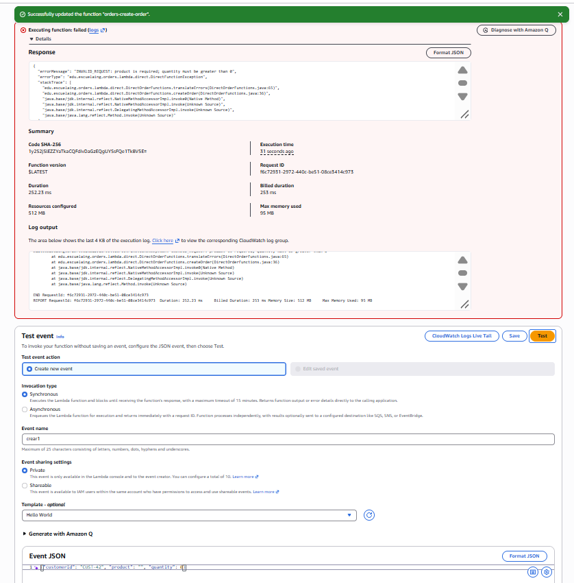

**03. `orders-get-order` with `{"id": "ORD-001"}`.** It returns one of the sample orders. The `Init duration` line shows the cold start of the Java runtime.

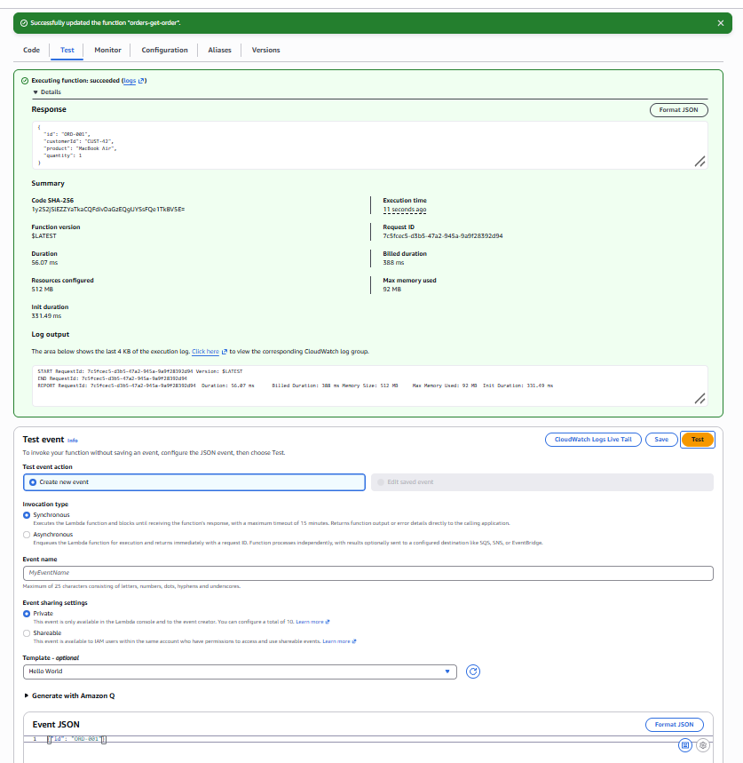

**04. Architecture A imported in API Gateway (`orders-api-mapping`)**, and the permissions that let API Gateway call the four Lambdas, added from CloudShell.

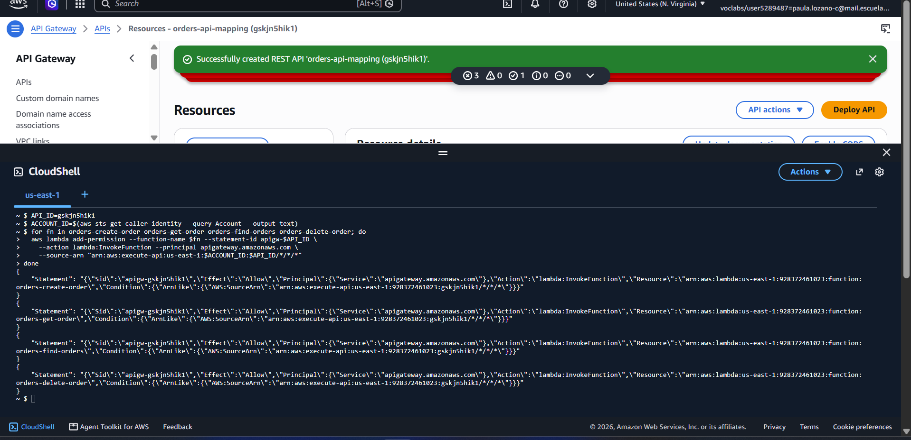

**05. Architecture B (`orders-api-proxy`):** permission for API Gateway to call the proxy Lambda.

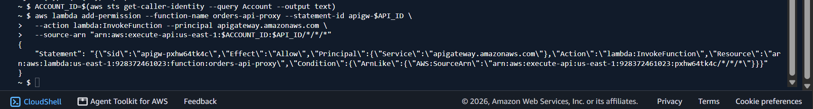

**06. Calling the deployed API (Architecture B, stage `Alpha_dev`) with `curl`.** `POST /orders` returns `201 Created` with `Location: /orders/ORD-004`, `GET /orders/ORD-001` returns `200 OK`, and `GET /orders/ORD-999` returns `404 Not Found` with the `ORDER_NOT_FOUND` error. (The `bash: ... command not found` lines are just the titles I pasted along with the commands.)

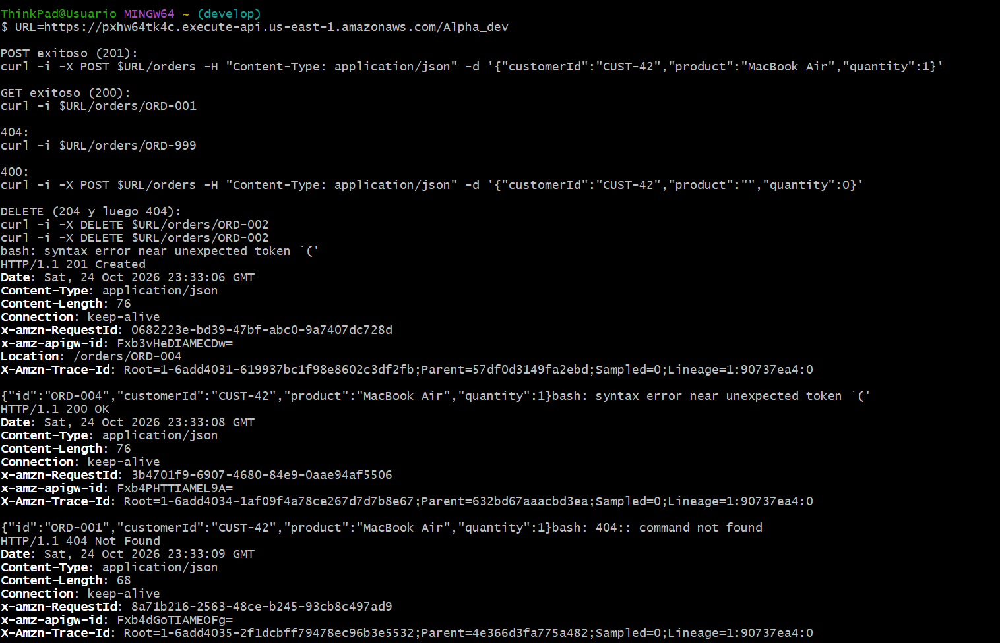

**07. More calls to the deployed API.** A `POST` with invalid data returns `400 Bad Request` with `INVALID_REQUEST`. The first `DELETE /orders/ORD-002` returns `204 No Content` and the second one returns `404 Not Found`, because the order is already gone.

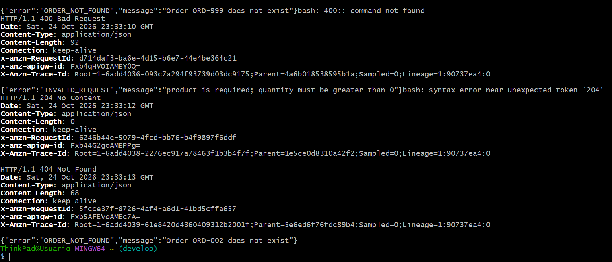

## 14. Demo video

Video: [docs/Demonstration.mp4](docs/Demonstration.mp4) (stored with Git LFS; open it on GitHub and click *Download* or *View raw*)

What it shows:

1. `mvn test` with all tests passing.
2. `mvn package` and the generated `target/orders-api-1.0.0.jar`.
3. A Lambda invoked directly from the console.
4. Calls to the deployed API with `curl`: a successful `POST` (201 with `Location`), a successful `GET` (200), a 404, a 400 and the `DELETE` extension (204 and then 404).
5. The architecture diagram.
